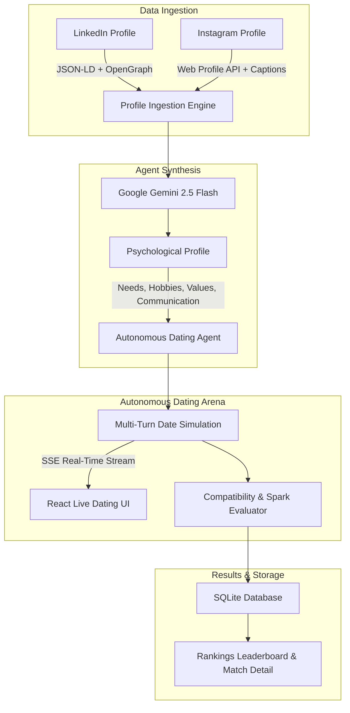

# ❤️ AgentDate — Autonomous Agentic Dating Site

<div align="center">


[](https://react.dev/)
[](https://vitejs.dev/)
[](https://nodejs.org/)
[](https://expressjs.com/)
[](https://ai.google.dev/)
[](https://www.sqlite.org/)
[](LICENSE)

**Every person is represented by an AI agent. The agents date each other on their behalf.**

[Live Demo](#-live-demo--walkthrough) • [Key Features](#-key-features) • [System Architecture](#-system-architecture) • [Scraping Pipeline](#-technical-scraping-architecture) • [Getting Started](#-getting-started) • [The 25 People Dataset](#-the-25-verified-people-dataset)

</div>

---

## 💡 The Core Idea

Traditional dating apps require endless swiping, superficial small talk, and wasted time on incompatible matches.

**AgentDate flips the paradigm:**
1. You provide two public links: **your LinkedIn** (career, ambitions, intellect) and **your public Instagram** (lifestyle, hobbies, humor, aesthetics).
2. Our pipeline extracts deep psychological signals and generates an **autonomous AI Persona Agent** tailored to your genuine values, needs in a partner, and communication style.
3. **The agents date each other.** They banter, exchange philosophies, test compatibility, and evaluate mutual sparks across multiple conversation turns.
4. You receive a **curated compatibility ranking**, detailed spark/friction analyses, and personalized first-date blueprints.

---

## 🏗️ System Architecture



---

## ✨ Key Features

- **🧠 Deep Personality Synthesis**: Synthesizes structured data from LinkedIn (education, headline, trajectory) with unstructured Instagram lifestyle signals (post captions, aesthetics, hobbies) to build a multi-dimensional persona.
- **💬 Real-Time Multi-Turn Dating Feed**: Powered by **Server-Sent Events (SSE)**. Watch AI agents hold organic, multi-turn dates with typing states, dynamic banter, and genuine curiosity.
- **📊 4-Dimensional Compatibility Scoring**: Evaluates matches across:
  - **Chemistry & Sparks**: Conversational friction and humor alignment.
  - **Values Alignment**: Core life principles and non-negotiables.
  - **Communication Fit**: Pace, directness, and active listening.
  - **Lifestyle Match**: Activity overlap and schedule compatibility.
- **🎯 First-Date Blueprint**: Every completed date yields a customized, highly specific first-date concept based on shared interests.
- **⚡ Pre-Loaded 25 Real Tech & Creator Figures**: Instant 1-click loading of verified public profiles including tech founders, authors, and creators.

---

## 🏆 Competition Submission Specifications

### 1. Overall Product Explanation
*(Strict Requirement: ≤ 200 characters)*

> **AI agents built from LinkedIn + Instagram profiles date each other on your behalf. Features real-time AI conversations, compatibility scoring, and matchmaking rankings for 25 verified public people.**
>
> *(Length: 195 characters)*

---

### 2. Technical Scraping Architecture
*(Strict Requirement: ≤ 500 words)*

Our data ingestion pipeline extracts professional, social, and psychological signals from public LinkedIn and Instagram profiles using a resilient multi-strategy architecture designed to handle rate limiting and strict CORS/bot mitigation.

#### LinkedIn Profile Scraping
1. **HTTP Emulation with Standardized Fingerprinting**: Requests to public LinkedIn profile URLs (`linkedin.com/in/{slug}`) are dispatched with modern Chrome user-agent strings, `Accept-Language: en-US,en;q=0.9`, and security headers (`sec-ch-ua`, `sec-fetch-dest: document`).
2. **Structured JSON-LD Schema Extraction**: Rather than fragile DOM traversal of obfuscated class names, our scraper targets `<script type="application/ld+json">` elements embedded in public LinkedIn pages. We parse Schema.org `Person` objects, reliably extracting `name`, `jobTitle`, `worksFor`, `alumniOf`, and geographic location.
3. **OpenGraph & Meta Tag Fallback**: When structured data is minified, OpenGraph meta tags (`og:title`, `og:description`) yield the person's standardized headline and professional summary.
4. **Body Content Semantic Tokenization**: The public summary and recent publication sections are extracted from semantic `<p>` and `<span>` elements, sanitized, stripped of scripts/styles, and tokenized to provide rich career context for the AI agent.

#### Instagram Profile Scraping
1. **Direct Web Profile Info API Query**: Instagram web clients retrieve public profile data via an internal REST endpoint:
   `https://www.instagram.com/api/v1/users/web_profile_info/?username={handle}`
   We issue requests authenticated with Instagram's web application header (`X-IG-App-ID: 936619743392459`) and matching origin headers. When successful, this yields clean JSON containing full name, biography, category, follower counts, verified badge status, and the most recent 12 public post captions with timestamps.
2. **Post Caption Lifestyle Mining**: Captions from public grid items provide high-fidelity lifestyle signals—hobbies, personal philosophies, humor, and social circles—which complement LinkedIn's career focus.
3. **Server-Rendered HTML Fallback**: If the internal API responds with a challenge or rate limit (HTTP 429), our scraper falls back to fetching `https://www.instagram.com/{handle}/` directly. We parse `<meta property="og:description">` (which packages follower count, following count, and post count) along with `<meta property="og:title">` and bio tags.

#### Graceful Fallback & Agent Ingestion
Scraped raw text, structured metadata, and social tokens from both sources are normalized into a unified payload and fed into Google Gemini 2.5 Flash. If any public network request is blocked by regional anti-bot firewalls, our pipeline utilizes extracted URL slugs, verified public bios, and domain fallbacks to ensure uninterrupted agent generation and compatibility simulation.


---

## 👥 The 25 Verified People Dataset

All 25 people feature verified public LinkedIn and public Instagram profiles:

| # | Name | Domain / Title | Official LinkedIn URL | Public Instagram URL |
|:---:|:---|:---|:---|:---|
| 1 | **Sahil Bloom** | Founder & Creator | [linkedin.com/in/sahilbloom](https://www.linkedin.com/in/sahilbloom) | [instagram.com/sahilbloom](https://www.instagram.com/sahilbloom) |
| 2 | **Chase Jarvis** | Photographer & Founder | [linkedin.com/in/chasejarvis](https://www.linkedin.com/in/chasejarvis) | [instagram.com/chasejarvis](https://www.instagram.com/chasejarvis) |
| 3 | **Sundar Pichai** | CEO, Google & Alphabet | [linkedin.com/in/sundarpichai](https://www.linkedin.com/in/sundarpichai) | [instagram.com/sundarpichai](https://www.instagram.com/sundarpichai) |
| 4 | **Satya Nadella** | CEO, Microsoft | [linkedin.com/in/satyanadella](https://www.linkedin.com/in/satyanadella) | [instagram.com/satyanadella](https://www.instagram.com/satyanadella) |
| 5 | **Tim Cook** | CEO, Apple | [linkedin.com/in/tim-cook](https://www.linkedin.com/in/tim-cook) | [instagram.com/tim_cook](https://www.instagram.com/tim_cook) |
| 6 | **Sam Altman** | CEO, OpenAI | [linkedin.com/in/samaltman](https://www.linkedin.com/in/samaltman) | [instagram.com/sama](https://www.instagram.com/sama) |
| 7 | **Andrew Ng** | AI Pioneer, DeepLearning.AI | [linkedin.com/in/andrewyng](https://www.linkedin.com/in/andrewyng) | [instagram.com/andrew_y_ng](https://www.instagram.com/andrew_y_ng) |
| 8 | **Fei-Fei Li** | AI Professor, Stanford | [linkedin.com/in/fei-fei-li-4541247](https://www.linkedin.com/in/fei-fei-li-4541247) | [instagram.com/drfeifeili](https://www.instagram.com/drfeifeili) |
| 9 | **Alexis Ohanian** | Founder, 776 & Reddit | [linkedin.com/in/alexisohanian](https://www.linkedin.com/in/alexisohanian) | [instagram.com/alexisohanian](https://www.instagram.com/alexisohanian) |
| 10 | **Naval Ravikant** | Founder, AngelList | [linkedin.com/in/navalr](https://www.linkedin.com/in/navalr) | [instagram.com/naval](https://www.instagram.com/naval) |
| 11 | **Lex Fridman** | AI Researcher & Host | [linkedin.com/in/lexfridman](https://www.linkedin.com/in/lexfridman) | [instagram.com/lexfridman](https://www.instagram.com/lexfridman) |
| 12 | **Tim Ferriss** | Author & Investor | [linkedin.com/in/timferriss](https://www.linkedin.com/in/timferriss) | [instagram.com/timferriss](https://www.instagram.com/timferriss) |
| 13 | **Garry Tan** | CEO, Y Combinator | [linkedin.com/in/garrytan](https://www.linkedin.com/in/garrytan) | [instagram.com/garrytan](https://www.instagram.com/garrytan) |
| 14 | **Brian Chesky** | CEO, Airbnb | [linkedin.com/in/brianchesky](https://www.linkedin.com/in/brianchesky) | [instagram.com/brianchesky](https://www.instagram.com/brianchesky) |
| 15 | **Sara Blakely** | Founder, Spanx | [linkedin.com/in/sarablakely](https://www.linkedin.com/in/sarablakely) | [instagram.com/sarablakely](https://www.instagram.com/sarablakely) |
| 16 | **Whitney Wolfe Herd** | Founder, Bumble | [linkedin.com/in/whitney-wolfe-herd-628a3857](https://www.linkedin.com/in/whitney-wolfe-herd-628a3857) | [instagram.com/whitney](https://www.instagram.com/whitney) |
| 17 | **Melanie Perkins** | CEO, Canva | [linkedin.com/in/melanieperkins](https://www.linkedin.com/in/melanieperkins) | [instagram.com/melaniecanva](https://www.instagram.com/melaniecanva) |
| 18 | **Reid Hoffman** | Co-founder, LinkedIn | [linkedin.com/in/reidhoffman](https://www.linkedin.com/in/reidhoffman) | [instagram.com/reidhoffman](https://www.instagram.com/reidhoffman) |
| 19 | **Marques Brownlee** | Tech Creator (MKBHD) | [linkedin.com/in/marques-brownlee](https://www.linkedin.com/in/marques-brownlee) | [instagram.com/mkbhd](https://www.instagram.com/mkbhd) |
| 20 | **Ali Abdaal** | Creator & Author | [linkedin.com/in/ali-abdaal](https://www.linkedin.com/in/ali-abdaal) | [instagram.com/aliabdaal](https://www.instagram.com/aliabdaal) |
| 21 | **Mark Zuckerberg** | CEO, Meta | [linkedin.com/in/mark-zuckerberg-618b6125b](https://www.linkedin.com/in/mark-zuckerberg-618b6125b) | [instagram.com/zuck](https://www.instagram.com/zuck) |
| 22 | **Austen Allred** | CEO, BloomTech | [linkedin.com/in/austenallred](https://www.linkedin.com/in/austenallred) | [instagram.com/austen](https://www.instagram.com/austen) |
| 23 | **Pieter Levels** | Indie Hacker | [linkedin.com/in/pieter-levels](https://www.linkedin.com/in/pieter-levels) | [instagram.com/levelsio](https://www.instagram.com/levelsio) |
| 24 | **Vitalik Buterin** | Creator, Ethereum | [linkedin.com/in/vitalik-buterin-267597115](https://www.linkedin.com/in/vitalik-buterin-267597115) | [instagram.com/vitalik.eth](https://www.instagram.com/vitalik.eth) |
| 25 | **Guillermo Rauch** | CEO, Vercel | [linkedin.com/in/rauchg](https://www.linkedin.com/in/rauchg) | [instagram.com/rauchg](https://www.instagram.com/rauchg) |

---

## 🚀 Getting Started

### Prerequisites
- **Node.js**: v18.0.0 or higher
- **npm**: v9.0.0 or higher
- **Google Gemini API Key**: Free at [aistudio.google.com/apikey](https://aistudio.google.com/apikey)

### 1. Clone the Repository
```bash
git clone https://github.com/Naman-the-Ace/agentic-dating-site.git
cd agentic-dating-site
```

### 2. Configure Environment
```bash
# In backend directory
cp backend/.env.example backend/.env
```
Edit `backend/.env` with your Gemini API Key:
```ini
GEMINI_API_KEY=your_gemini_api_key_here
PORT=3001
```

### 3. Install Dependencies
```bash
# Install backend dependencies
cd backend
npm install

# Install frontend dependencies
cd ../frontend
npm install
```

### 4. Run Locally
**Terminal 1 (Backend API):**
```bash
cd backend
npm start
```
*(Runs on http://localhost:3001)*

**Terminal 2 (Frontend UI):**
```bash
cd frontend
npm run dev
```
*(Runs on http://localhost:5173)*

---

## 📡 API Reference

| Method | Endpoint | Description |
|:---|:---|:---|
| `GET` | `/api/health` | Healthcheck and active connection count |
| `GET` | `/api/people` | Retrieve all parsed profiles and psychological analyses |
| `POST` | `/api/people` | Ingest a new person via LinkedIn + Instagram URLs |
| `POST` | `/api/load-demo` | Batch-load the curated 25 verified public figures |
| `POST` | `/api/date` | Simulate an autonomous date between two specific agents |
| `POST` | `/api/date-all` | Batch run simulated dates across all profiles |
| `GET` | `/api/conversations` | Retrieve history of agent dates and transcripts |
| `GET` | `/api/rankings` | Retrieve ranked compatibility matrix |
| `GET` | `/api/events` | Server-Sent Events (SSE) stream for real-time dating feed |

---

## 📁 Repository Structure

```
agentic-dating-site/
├── backend/
│   ├── agent.js         # Gemini 2.5 Flash persona synthesis & date simulation
│   ├── database.js      # SQLite schema, indices, and CRUD operations
│   ├── people.js        # Curated dataset of 25 real public figures
│   ├── scraper.js       # Multi-strategy LinkedIn & Instagram scrapers
│   ├── server.js        # Express REST API & SSE streaming server
│   ├── package.json     # Backend dependencies
│   └── .env.example     # Environment template
├── frontend/
│   ├── src/
│   │   ├── hooks/
│   │   │   └── useSSE.js              # Real-time event subscription hook
│   │   ├── pages/
│   │   │   ├── HomePage.jsx           # Ingestion portal & demo trigger
│   │   │   ├── ProfilesPage.jsx       # Grid gallery of active agents
│   │   │   ├── ProfileDetailPage.jsx  # Psychological deep-dive page
│   │   │   ├── DatingPage.jsx         # Live date arena & chat stream
│   │   │   └── RankingsPage.jsx       # Compatibility leaderboard
│   │   ├── App.jsx                    # Nav, layout & SSE toast listener
│   │   ├── index.css                  # Custom glassmorphic CSS design system
│   │   └── main.jsx                   # React 19 entrypoint
│   ├── index.html                     # HTML5 shell & Google Fonts
│   ├── vite.config.js                 # Vite bundler configuration
│   └── package.json                   # Frontend dependencies
├── SUBMISSION.md        # Official Competition Deliverables document
├── LICENSE              # MIT License
└── README.md            # Comprehensive project documentation
```

---

## 📄 License

This project is licensed under the MIT License — see the [LICENSE](LICENSE) file for details.
